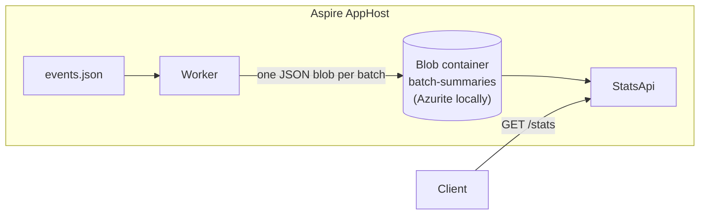

# Azure Event Pipeline

A small distributed .NET app that processes a stream of synthetic trade events, writes a JSON summary per batch to Azure Blob Storage, and serves aggregated statistics over HTTP.

I built it to learn the stack used day to day on Azure Core, in three phases that build on each other:

1. **Worker Service**: a `BackgroundService` with dependency injection, validated options and structured logging.
2. **Azure SDK for .NET**: per-batch summaries uploaded with `Azure.Storage.Blobs`, authenticated with Azure identity instead of secrets.
3. **Aspire**: an AppHost that runs the worker, a stats API and a local storage emulator together, with shared telemetry.

The event model is a simplified version of a C++ matching engine I wrote earlier.

## Architecture



| Project | Role |
|---|---|
| `EventProcessor.Worker` | `BackgroundService`. Each tick it reads the next batch of events, summarizes it per symbol, and uploads the summary as a blob. |
| `EventProcessor.StatsApi` | Minimal API. `GET /stats` aggregates today's batch summaries. Responses are cached for 10 seconds. |
| `EventProcessor.AppHost` | Aspire orchestration. Starts an Azurite storage emulator, then the worker and API, and wires their connection settings. |
| `EventProcessor.ServiceDefaults` | Shared setup: OpenTelemetry, health checks, service discovery and HTTP resilience. |
| `EventProcessor.Contracts` | Types shared by worker and API (`BatchSummary`, `SymbolSummary`, `StatsResponse`) and the single `JsonSettings` used to write and read blobs. |

## Prerequisites

- [.NET 10 SDK](https://dotnet.microsoft.com/download)
- Docker, running (Aspire starts the Azurite storage emulator as a container)
- Optional: Azure CLI and an Azure Storage account, only for [running against real Azure](#running-against-real-azure)

## Quick start

```bash
dotnet run --project src/EventProcessor.AppHost
```

The console prints a link to the Aspire dashboard that includes a login token. Open it to see three resources: `storage` (Azurite), `worker` and `statsapi`.

The worker writes a batch summary every 2 seconds. To read the aggregate:

```bash
curl -sk https://localhost:7162/stats
```

The emulator has no persistent volume, so every run starts with empty storage and the counts begin at zero.

If your browser rejects the HTTPS development certificate, run `dotnet dev-certs https --trust`.

## The `/stats` endpoint

`GET /stats` returns totals for today's batches (UTC). This is an example after 107 batches, formatted for readability:

```json
{
  "batchCount": 107,
  "eventCount": 321,
  "symbols": [
    { "symbol": "AAPL", "tradeCount": 128, "buyQty": 0,     "sellQty": 8320, "vwap": 245.8077 },
    { "symbol": "MSFT", "tradeCount": 129, "buyQty": 11300, "sellQty": 0,    "vwap": 525.8987 },
    { "symbol": "NVDA", "tradeCount": 64,  "buyQty": 7680,  "sellQty": 0,    "vwap": 180.25 }
  ]
}
```

| Field | Meaning |
|---|---|
| `batchCount` | Number of batch summaries written today |
| `eventCount` | Total events across those batches |
| `tradeCount`, `buyQty`, `sellQty` | Per-symbol totals |
| `vwap` | Volume-weighted average price across all batches |

`vwap` is weighted by quantity: `Σ(batch VWAP × batch quantity) / Σ quantity`. Averaging the per-batch VWAPs would be wrong, because a 10-share batch would count as much as a 10,000-share one.

Responses can be up to 10 seconds old. The `Age` response header shows how old a cached response is.

## Configuration

Worker settings are bound from configuration and validated at startup, so invalid values stop the process before it does any work.

| Key | Default | Notes |
|---|---|---|
| `EventProcessor:BatchSize` | `3` | Events per batch, 1–1000 |
| `EventProcessor:IntervalSeconds` | `2` | Delay between batches, 1–3600 |
| `BlobStorage:ContainerName` | `batch-summaries` | |
| `BlobStorage:AccountUri` | (set in `appsettings.json`) | Uses token-based auth, so no secret is needed |
| `BlobStorage:ConnectionString` | none | Fallback only. Keep it in user secrets, never in the repo. |
| `ConnectionStrings:blobs` | injected by Aspire | Points at the emulator when run under the AppHost |

The worker picks its storage connection in this order:

1. `ConnectionStrings:blobs`, when running under the AppHost
2. `BlobStorage:AccountUri` with an Azure credential
3. `BlobStorage:ConnectionString`

Any setting can be overridden on the command line (`-- --EventProcessor:BatchSize=5`) or with an environment variable (`EventProcessor__BatchSize=5`).

## Running against real Azure

The worker can run on its own against a real storage account:

```bash
az login
dotnet run --project src/EventProcessor.Worker
```

It authenticates with an identity rather than a key. The credential depends on the environment:

- **Development**: `AzureCliCredential`, which uses your `az login` session.
- **Other environments**: `ManagedIdentityCredential`, the identity of the Azure resource the app runs on.

Your identity needs the **Storage Blob Data Contributor** role on the storage account. Owner or Contributor is not enough, because those are control-plane roles that manage the account, not its data.

```bash
az role assignment create \
  --assignee "$(az ad signed-in-user show --query id -o tsv)" \
  --role "Storage Blob Data Contributor" \
  --scope "$(az storage account show -n <account> -g <resource-group> --query id -o tsv)"
```

Role assignments can take a few minutes to take effect.

## How to verify it works

- **Blobs**: summaries are stored as `yyyy/MM/dd/{BatchId}.json` with content type `application/json`. List them with `az storage blob list --account-name <account> -c batch-summaries --auth-mode login -o table`.
- **Structured logs**: in the dashboard, `BatchId`, `EventCount`, `Symbol` and `Vwap` appear as separate, filterable fields.
- **Traces**: a cache miss on `/stats` shows a blob list and one download per blob as child spans. A cache hit is a single span that takes well under a millisecond.
- **Hand-checkable numbers**: `events.json` holds 5 events and each batch takes 3, so after `n` batches every total can be predicted by hand. For example, 30 batches is 90 events, exactly 18 passes through the file.

## Design decisions and trade-offs

- **At-most-once delivery.** The event cursor advances before the upload. If an upload fails, that batch is logged and skipped. At-least-once delivery would need the cursor to advance only after a successful write, with retries using the same `BatchId`, so a retry overwrites the same blob instead of creating a duplicate.
- **One failure doesn't stop the service.** Each batch is wrapped in its own error handling. Shutdown (`OperationCanceledException`) is handled separately so it stays clean.
- **Fail fast on configuration, retry on data.** Invalid settings fail at startup. Missing or unreachable input is retried on the next tick, so the worker recovers on its own when the problem goes away.
- **One serializer contract.** Worker and API share `JsonSettings`. An earlier bug, where the API read every blob back as default values, came from the two sides using different JSON settings.
- **A 10-second output cache.** The worker writes every 2 seconds, so a cached response is at most about 5 batches behind, which is acceptable for a dashboard. The cache's stampede protection means concurrent requests on a cold cache trigger one computation, not many.
- **Measured cost of a cache miss.** A miss downloads every blob for the day, one at a time, at about 2.6 ms per blob against the local emulator, so cost grows linearly. At large volumes the next step would be a running aggregate or a daily rollup rather than reading every blob.

## Limitations and next steps

- Input is a fixed JSON file that loops forever. A real source would be Azure Event Hubs or Service Bus.
- `/stats` has no authentication.
- There are no automated tests yet. `BatchSummarizer` is pure logic and the natural place to start.
- It runs locally only. Deploying with Aspire to Azure Container Apps is the next step, and would exercise the managed identity path.
